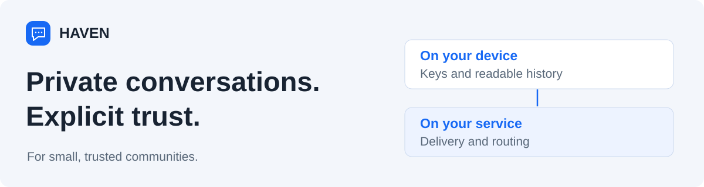
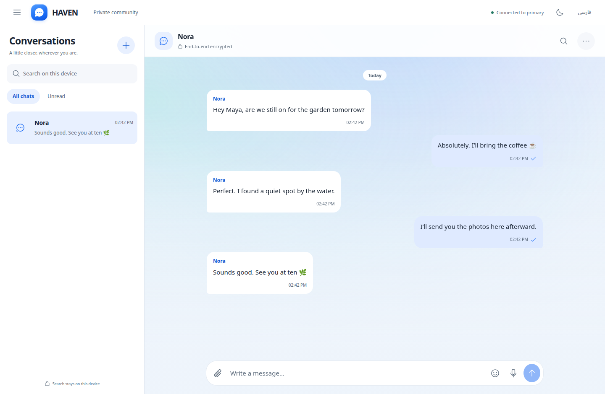
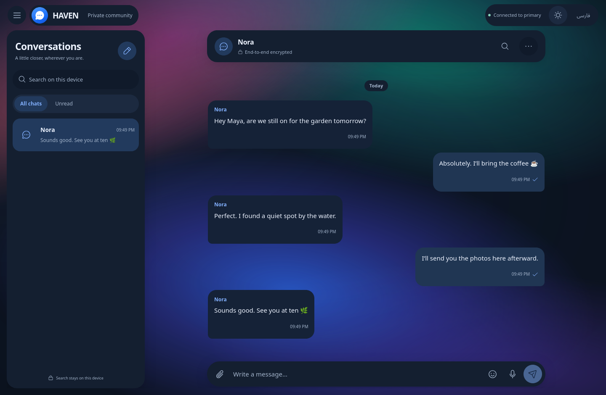
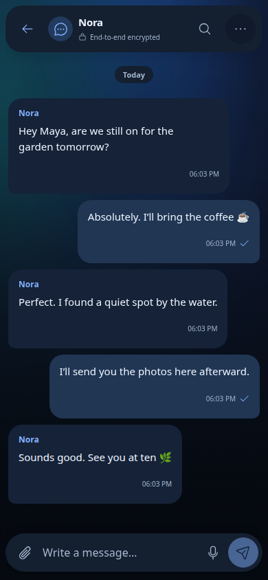
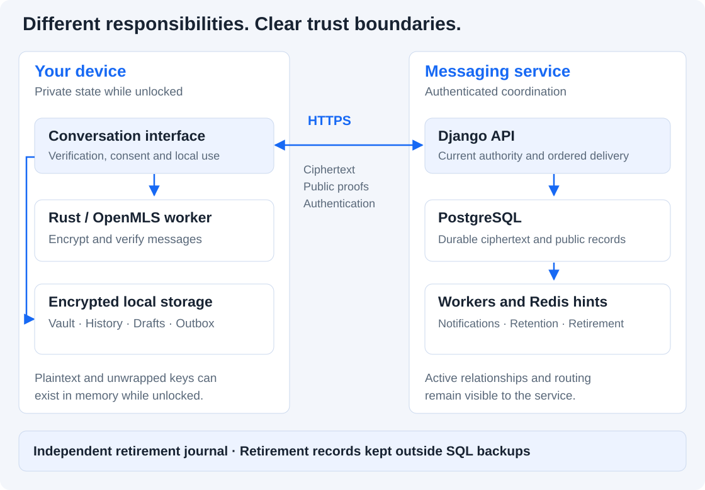

<p align="center">
  
</p>

# HAVEN

**A self-hosted messenger for small, trusted communities.**

HAVEN brings together end-to-end encryption for direct and group conversations, explicit device approval, encrypted local history, and a familiar interface in English and Persian.

Its design follows the life of a conversation: who can join, where keys live, how messages survive interrupted delivery, how readable history is recovered, and when shared server history can be retired by agreement. A signed installed client also separates the software handling your keys from the messaging server carrying your data.

[Get started](#get-started) · [Architecture](docs/architecture/README.md) · [Security design](docs/security/design-guide.md) · [Verification](TEST_REPORT.md)

[](https://github.com/rezahadinezhad/HAVEN/actions/workflows/repository-security.yml) · [MIT license](LICENSE)

> Messaging, mutual conversation retirement, and verified Linux client delivery are implemented. Independent security review and public-deployment qualification remain pending. See [current security status](SECURITY_STATUS.md).

## A familiar place for private conversations

[](.github/assets/conversation-desktop.png)

Direct chats and groups share the same conversation interface: replies, edits, reactions, local search, voice notes, and encrypted photos, videos, audio, and files. Local previews make it clear what you are about to send. Delivery indicators describe observed state; server acceptance does not imply that another person has read a message.

The conversation workspace uses two panes, with an inset rounded conversation list and independently floating chat header and composer. Settings and account tools open through a compact navigation panel. Blue, mint and rose aurora bands flow across the canvas behind readable message bubbles and can be paused; local typing receives subtle visual feedback. Optional remote typing indicators are off by default and expire after five seconds.

The interface supports English and Persian, right-to-left and mixed-direction text, light and dark themes, keyboard navigation, reduced motion, and layouts for smaller screens. Local history remains available after it has been saved and the vault is unlocked; remote delivery still needs a connection.

<details>
<summary>Dark theme and a smaller screen</summary>

<p>
  <a href=".github/assets/conversation-dark.png"></a>
  <a href=".github/assets/conversation-mobile.png"></a>
</p>

</details>

<sub>Actual application captures from an isolated encrypted conversation with disposable synthetic accounts. A mobile viewport demonstrates layout, not physical iOS/Android qualification. [Capture provenance](.github/assets/README.md).</sub>

## Three separate steps of trust

An account is not the same thing as an encryption identity, and signing in is not the same thing as unlocking message keys.

| Step | What it authorizes |
|---|---|
| **Sign in** | Access your account through a password-bound, revocable session. |
| **Approve this device** | Establish its signed device identity and permission to participate. Additional devices need approval; peer fingerprints still require independent comparison. |
| **Unlock the local vault** | Decrypt this device's saved keys and history with its local secret. |

For example, signing in on a new browser does not silently give that browser an existing device's keys. An account password reset cannot reconstruct lost message keys. Recovery establishes fresh identity state; history imports provide readable records rather than resume an old cryptographic ratchet. [Device trust and recovery](docs/security/design-guide.md#identity-login-and-unlock).

## Your device, your service

[](.github/assets/architecture.svg)

The **client** encrypts and decrypts messages, verifies identities and ordered history, and saves encrypted local state. It uses [Messaging Layer Security](https://www.rfc-editor.org/rfc/rfc9420.html) through OpenMLS, compiled from Rust to WebAssembly. Direct chats are groups of device identities too.

The **Django API** checks current account/device authority and coordinates delivery. **PostgreSQL** holds authoritative encrypted envelopes, signed public records, and authentication/routing state. **Redis** carries transient synchronization hints and rate-limit state; it does not replace durable message storage.

Separate workers publish notifications, maintain retention, and retire eligible conversations. The notification worker uses a narrow SQL credential. An authenticated retirement journal is retained independently of SQL so restoring an older database cannot silently undo recorded retirement.

The service still sees active relationships, routing, timing and other processing metadata. Message encryption is not anonymity. [Component responsibilities and data custody](docs/architecture/README.md).

## A message should survive an interrupted send

Sending involves more than an encryption operation:

1. The client prepares an encrypted message and saves the resulting crypto state and pending request together in its encrypted vault.
2. The API checks current authority and commits the ordered record before returning acceptance.
3. A recipient retrieves the encrypted envelope, verifies its history/sender/MLS context, and commits its local state before acknowledging it.

A lost response triggers a retry of the **saved request bytes**, rather than a fresh encryption operation. A Redis hint prompts synchronization; authoritative history comes from the API. If local persistence fails, the client does not acknowledge state it failed to save.

Segmented encrypted history avoids rewriting every old message when a draft changes. Resource limits reject work explicitly, and authenticated malformed application content can be quarantined without making later valid messages unreadable. [Message flow and failure behavior](docs/architecture/README.md#the-message-journey).

## Keep local history. Retire shared records by agreement.

HAVEN has two distinct retention mechanisms.

**Routine cleanup** makes delivered application ciphertext eligible for removal after a minimum age of 24 hours and durable acknowledgement from every eligible device. Unacknowledged ciphertext and required public control history remain. Ordinary attachments have a seven-day maximum lifetime. [Retention policy](docs/security/server-data-retention.md).

**Mutual conversation closure** goes further. One approved device already participating in the conversation represents each account. Direct chats require both accounts; groups require every historically affected account, including former members. Neither a majority nor an administrator can substitute for consent.

Representatives save available encrypted history, agree on the final signed head, explicitly consent, and save the mutual final certificate before signing receipts. The worker removes eligible conversation records only after required dependencies settle and an independent retirement exclusion is persisted.

Preparation pauses sending for that account and currently cannot be cancelled or transferred. Missing consent preserves server history and can leave a conversation paused. Archives disclose unavailable history/media and exclude view-once content. Retirement does not erase old backups, recipient copies, physical storage traces, or prior observations. [Closure, archives and restoration safeguards](docs/security/account-closure/README.md).

## Know which software handles your keys

Encryption assumes trustworthy client code. HAVEN provides three delivery choices:

| Client | Who supplies executable code? | Boundary |
|---|---|---|
| **Ordinary website** | The messaging website/operator | A compromised origin can replace its code. |
| **Independent web frontend** | A separately controlled frontend host | The API supplies data; the frontend host remains trusted. |
| **Verified installed client** | A signed release checked against a pinned publisher root | The API cannot replace the installed interface, workers, WASM or runtime through its responses. |

The portable Linux client serves authenticated assets through local HTTPS and uses a constrained bridge to the fixed messaging API. Manual updates reject changed payloads, installed-state rollback and conflicting versions. Separate dependency environments and browser/process locks protect the version switch.

Initial installation, the publisher/build pipeline, browser and OS remain trusted. The local deployment demonstrates the boundary; resilience to host-root compromise requires independently controlled infrastructure and signing. This is not an app-store-signed mobile application. [Delivery architecture and installation](docs/security/client-delivery/README.md).

## The decisions behind the behavior

The design has grown through concrete failure cases: interrupted sends, oversized local history, requests racing with revocation, incidental metadata copies, stalled group consent, restored SQL snapshots, and hostile client-code delivery.

Those problems led to atomic encrypted checkpoints, exact-request retries, current-authority fences, scoped reads and worker credentials, account-wide signed finality, independent replay exclusions, and authenticated installed releases. Each choice has a purpose and a limit. The [security design guide](docs/security/design-guide.md) connects those decisions to their implementation and verification records.

View-once media follows the same approach: one opening session per recipient account across approved devices, with explicit limits. It cannot prevent screenshots, a modified client, or a recipient recording plaintext. [View-once design](docs/adr/0005-view-once-media.md).

## Evidence you can inspect

| Behavior | Where to review it |
|---|---|
| Native MLS, tampering, replay, encrypted media and durable state | [Verification index](TEST_REPORT.md), [crypto source](packages/crypto-core), [browser tests](apps/web/tests) |
| Account-wide closure, final archives and SQL restore denial | [Closure verification](docs/security/account-closure/verification.md) |
| Signed updates, rollback refusal and hostile API code while a vault is unlocked | [Verified-client checks](docs/security/client-delivery/verification.md) |
| Guided setup, migrations, backups and actual runtime checks | [Installation upgrade record](docs/operations/installation-upgrade-2026-11-04/README.md) |
| Publication hygiene, dependency advisories and runtime regressions | [GitHub Actions](https://github.com/rezahadinezhad/HAVEN/actions/workflows/repository-security.yml) |

These are engineering checks of specific behaviors and revisions. They do not add up to an independent audit, global fork-detection proof, throughput SLA, or physical-phone qualification. The server still observes active metadata; an unlocked or compromised endpoint can expose plaintext. [Threats and remaining assurance work](SECURITY_STATUS.md).

## Get started

For guided Docker setup:

```bash
git clone https://github.com/rezahadinezhad/HAVEN.git
cd HAVEN
./setup.sh
```

The wizard creates unique secrets, prepares database roles/migrations and the retirement journal, starts an isolated stack, and verifies HTTPS/login. It prints the address and protected credential/management paths; interrupted setup can resume without replacing secrets.

This path requires Python 3.10+, OpenSSL, a Linux x86_64 Docker engine, and Compose 2.24.4+. Initial builds need access to pinned images and package registries. Local evaluation prepares separate browser trust when supported; server mode needs independently trusted matching TLS and reachable infrastructure. Never bypass certificate errors.

| Your next step | Guide |
|---|---|
| Evaluate or operate the service | [Guided setup](docs/runbooks/guided-setup.md) · [First conversation](docs/user-onboarding/README.md) |
| Install the verified client or separate web frontend | [Client delivery operations](docs/security/client-delivery/operations.md) — a separate trust/install step from the service wizard |
| Develop and run checks | [Contributor setup](CONTRIBUTING.md) · [Source development](docs/development.md) |
| Assess the design and deployment | [Architecture](docs/architecture/README.md) · [Security design](docs/security/design-guide.md) · [Operator runbook](docs/runbooks/operations.md) |

## Find your way through the source

| Path | Responsibility |
|---|---|
| [`apps/web`](apps/web) | Shared conversation UI, encrypted local storage/media, translations and browser tests |
| [`apps/verified-client`](apps/verified-client) | Installed release verification, local HTTPS/API bridge and independent frontend runtime |
| [`apps/api`](apps/api) | Authentication, device authority, ordered delivery, media, closure and migrations |
| [`packages/crypto-core`](packages/crypto-core) | OpenMLS adapter, Rust/WASM, public-only native verifier and pinned providers |
| [`packages/contracts`](packages/contracts) | API/WebSocket contracts and generated types |
| [`infrastructure`](infrastructure) · [`scripts`](scripts) | Deployment, PKI, build, maintenance and backup/restore tools |
| [`docs`](docs/README.md) | Current guides, architecture decisions and dated evidence |

## Contribute or review

Contributions to correctness, usability, documentation and reproducible verification are welcome. Start with [CONTRIBUTING.md](CONTRIBUTING.md). Report vulnerabilities privately using [SECURITY.md](SECURITY.md); keep real messages, credentials, invitation tokens and recovery material out of public issues.

Original HAVEN code and documentation use the **[MIT License](LICENSE)**. Dependencies, fonts, icons and vendored sources retain their own [licenses and notices](THIRD_PARTY_NOTICES.md).
