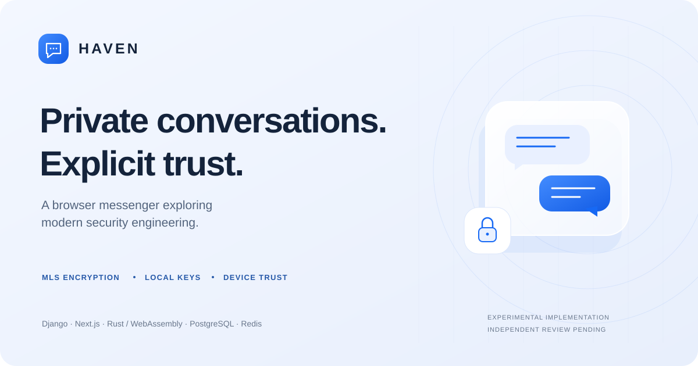
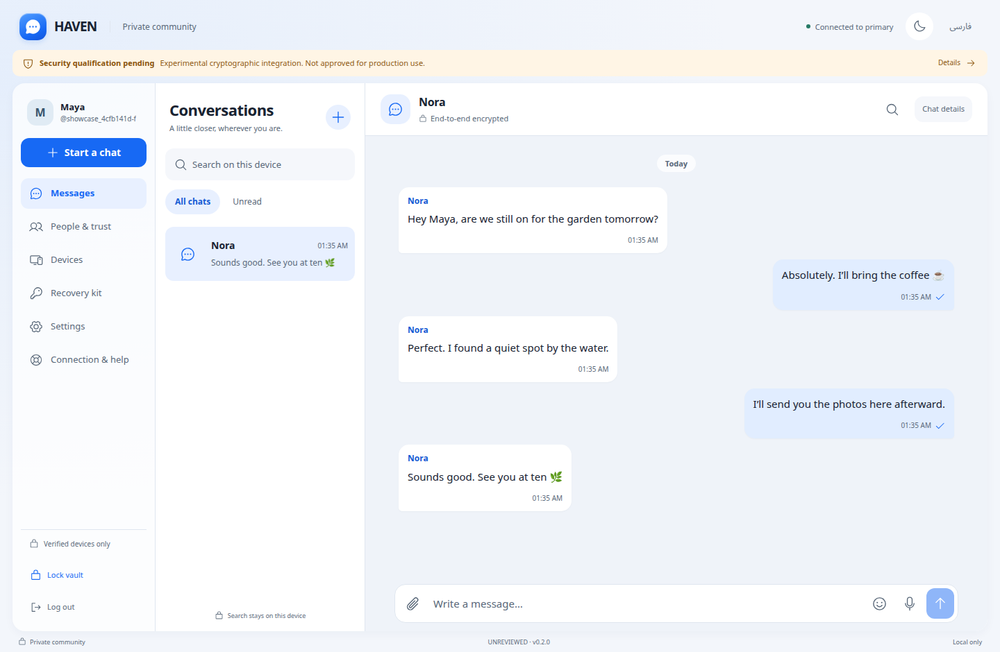
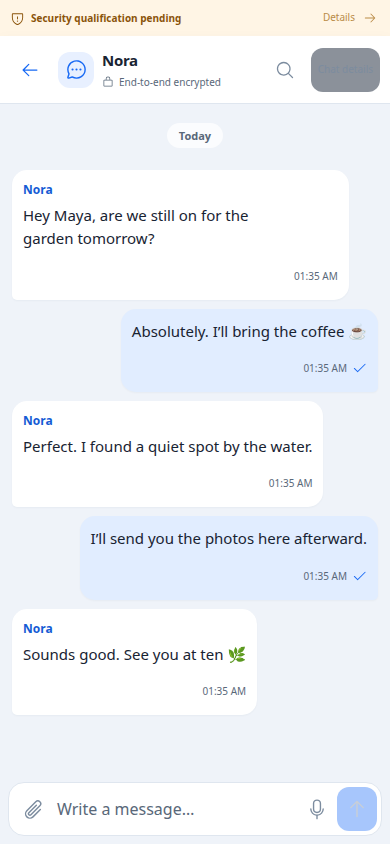
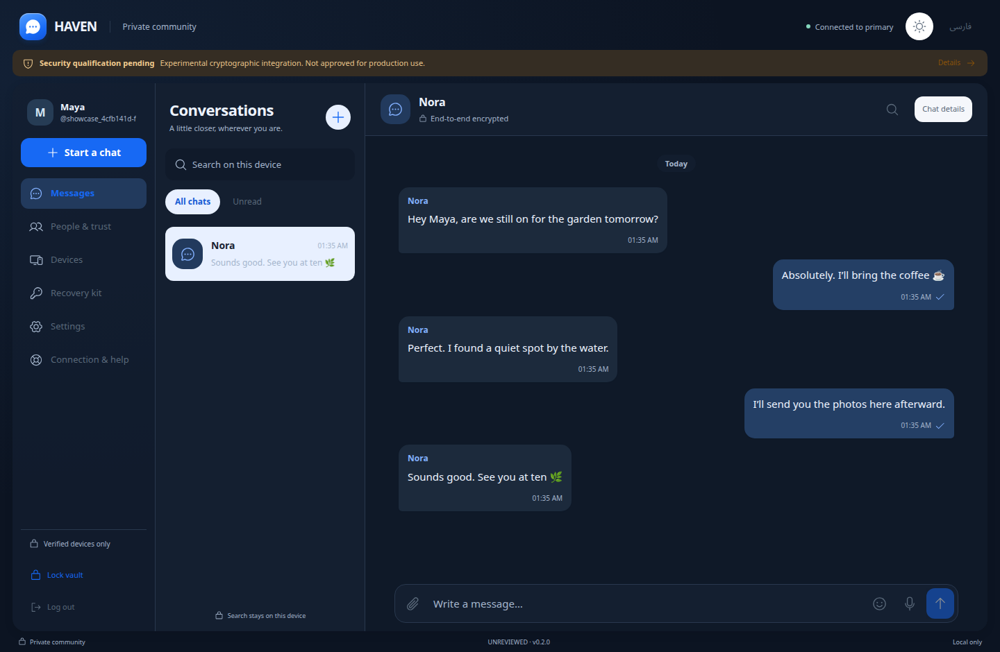
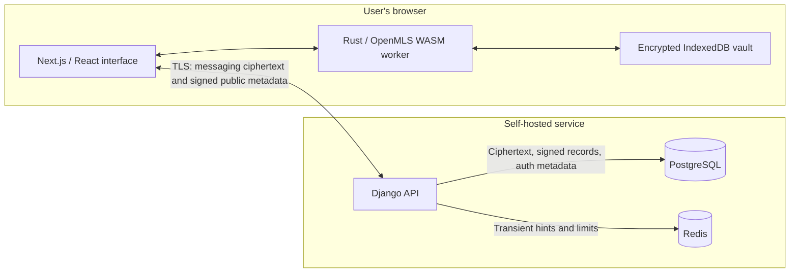

<p align="center">
  
</p>

# HAVEN

**A practical exploration of modern security architecture, built as a private browser messenger.**

HAVEN brings together standards-based group encryption, explicit device trust, encrypted local storage, and a familiar conversation interface. It explores what happens when security requirements shape the whole product—from the first invitation to session revocation, media delivery, and account recovery.

The result is a functioning, self-hosted implementation built with **Django, Next.js, PostgreSQL, Redis, and Rust/WebAssembly**. It runs in the browser, supports English and Persian, and serves its application assets and cryptographic libraries locally.

[](https://github.com/rezahadinezhad/HAVEN/actions/workflows/repository-security.yml)
[MIT license](LICENSE) · [Security model](#security-model) · [Local evaluation](#local-evaluation) · [Test evidence](TEST_REPORT.md) · [Contributing](CONTRIBUTING.md)

> [!IMPORTANT]
> **Experimental software; independent security review is pending.** Local tests demonstrate implemented behavior, not a security certification. Production onboarding remains disabled by a source-level gate. Read [SECURITY_STATUS.md](SECURITY_STATUS.md) before evaluating or deploying the project.

## The engineering question

Content encryption is one part of a private messenger. The harder product questions surround it: how a person trusts a new browser, where keys live, how a queued message survives a restart, what revocation actually stops, and which metadata the server still needs.

HAVEN treats those questions as implementation requirements. Its value is the connection between the interface, protocol state, delivery guarantees, and operational controls—and the documented tests and limits behind each decision.

## Inside HAVEN

<p align="center">
  
</p>

<details>
<summary>Mobile and dark mode</summary>

<p align="center">
  
  &nbsp;&nbsp;
  
</p>

</details>

<sub>Actual application captures from isolated local evaluation, using synthetic accounts and messages. They illustrate the implemented interface, not a hosted production service.</sub>

## What is implemented

| Capability | Behavior |
|---|---|
| **Private conversations** | Direct and group messaging through real OpenMLS in the browser. Replies, edits, reactions, local search, and observed delivery states. |
| **Explicit device trust** | Invite-only accounts, signed browser enrollment, approval from an existing trusted device, and independent fingerprint comparison. |
| **Encrypted media** | Photos, videos, files, audio, and voice notes. Local previews before sending; media keys and descriptive metadata travel inside encrypted messages. |
| **View-once photos and videos** | One opening session per recipient account across devices. Capture and remote-erasure limitations are disclosed before use. |
| **Local key custody** | Encrypted IndexedDB vault, encrypted drafts/outbox, inactivity and navigation locks, and optional WebAuthn PRF unlock on compatible trusted hostnames. |
| **Reliable delivery** | Durable PostgreSQL acceptance, ordered signed histories, retryable encrypted outbox, and cached local history. Redis carries transient hints and rate-limit state. |
| **Account protection** | Secure cookies, CSRF and exact Origin checks, credential-bound sessions, revocation checks, bounded unfinished sign-ins, and explicit recovery. |
| **Considered interface** | Responsive desktop/mobile layouts, light/dark themes, English/Persian and RTL support, keyboard interaction, and reduced-motion behavior. |
| **Self-hosted operations** | Separate database roles, TLS-only access, encrypted backup tooling, signed artifact tooling, retention cleanup, and documented deployment procedures. |

## Security model

### Cryptography and trust

| Layer | Implementation |
|---|---|
| Message encryption | RFC 9420 Messaging Layer Security through OpenMLS 0.9.2. HAVEN selects suite `0x0001`: X25519, AES-128-GCM, SHA-256, and Ed25519. |
| Provider maintenance | A pinned upstream provider backport resolves the recorded Rust vulnerability entries. Source hashes, licenses, the compatibility patch, and old/new build tests are retained. See [ADR 0010](docs/adr/0010-upstream-provider-security-backport.md). |
| Vault protection | Argon2id with a 64 MiB/three-pass profile and authenticated encryption, executed in a worker. Unwrapped state is held in memory while unlocked. |
| Attachments | Independent random attachment keys and XChaCha20-Poly1305 chunks, with authenticated binding to the conversation, attachment, and chunk positions. |
| Device identity | Signed enrollment/session challenges, existing-device approval, client fingerprint pins, and checked MLS membership transitions. |
| Session lifecycle | Django-derived session binding and constant-time verification. Concurrent password updates are serialized; sessions expire and can be revoked. The browser locks on navigation and inactivity. See [ADR 0011](docs/adr/0011-session-and-browser-key-lifecycle.md). |

**Account login, device approval, and vault unlock are separate boundaries.** An account password does not restore lost message keys or silently authorize a replacement identity. Recovery creates fresh credentials and requires peers to verify the change.

### Restrained server retention

The server stores routing and authentication information, ciphertext, and the signed public records needed for delivery and membership. It does not receive the client vault's private MLS state or attachment decryption keys through the normal protocol.

Delivered application ciphertext becomes eligible for retirement after every eligible device has durably acknowledged it and a minimum age of 24 hours has passed. Unsynchronized ciphertext and required signed/control history remain. Attachments have a seven-day lifetime; cleanup also retires expired sessions, invitations, and challenges. [Retention details and backup limits](docs/security/server-data-retention.md).

### Boundaries that remain

- **Browser code distribution is a trust boundary.** A compromised application origin can deliver code that steals plaintext or keys after unlock. CSP and local assets reduce exposure; they do not eliminate that risk.
- **Encryption is not anonymity.** The service and network infrastructure can observe account/device relationships, routing, timing, sizes, and live network addresses. A stolen database still reveals metadata.
- **View-once is a cooperating-client access control.** It cannot prevent screenshots, modified clients, retained recipient copies, or all memory/cache recovery.
- **The complete integration is not independently audited.** Physical mobile testing, capacity and infrastructure qualification, remaining container OS findings, and independent application/cryptographic review are still outstanding.

These limits are part of the design record. See the [threat model](docs/threat-model), [security status](SECURITY_STATUS.md), and [architecture decisions](docs/adr).

## Architecture



The browser handles message encryption, verification, and local key storage. Django enforces account/device authorization and coordinates durable delivery. PostgreSQL is the authoritative store; Redis notifications help synchronization but do not replace it. TLS protects account authentication and transport metadata as well as the encrypted messaging traffic.

## Local evaluation

Prepared native server artifacts target **Linux x86_64**. Prerequisites: Docker/Compose, Python 3.12/uv, Node.js, Rust, OpenSSL, and the browser trust tooling described in the [operations runbook](docs/runbooks/operations.md). Exact versions are recorded in `.nvmrc`, `.python-version`, `rust-toolchain.toml`, and the dependency lockfiles.

```bash
git clone https://github.com/rezahadinezhad/HAVEN.git
cd HAVEN
cargo install wasm-bindgen-cli --version 0.2.105 --locked -j 2
make prepare
make dev
```

The gated app is served at **https://127.0.0.1:8443**. Keep that terminal open. In a second terminal:

```bash
make integration-dev
```

The isolated evaluation messenger is **https://127.0.0.1:8445**. Its settings refuse non-loopback hosts and keep real encryption, authentication, CSRF, device approval, and TLS checks in place. It is not a production enable switch.

In a third terminal, prepare the isolated test browser and disposable credentials:

```bash
make browser-test-prepare
make test
```

The generated test credentials live in a mode-0600 file under `.local`; there are no shipped fixed passwords. Trust the disposable test CA only in the isolated browser profiles prepared by the tooling. **Never bypass a certificate error or install the test signing key on a server.** See [first conversation and invitations](docs/user-onboarding/README.md) for the user flow.

The optional device unlock requires a compatible WebAuthn PRF authenticator and a trusted HTTPS hostname. Raw-IP origins keep the passphrase/password-manager path; simply changing hostname does not migrate a browser's vault. [Design and support limits](docs/adr/0009-optional-device-unlock.md).

A running local server uses an immutable copy of its completed build. After rebuilding, restart `make dev` to evaluate the new assets.

## Verification and development

Recorded local evidence includes:

- **70 API tests** for authentication, authorization, sessions, concurrency, migrations, retention, attachments, and device enrollment.
- **205 upstream protocol vector tests passed**, with ignored/filtered/unsupported-suite cases recorded.
- Native Rust properties and browser tests covering interoperability, prior-build compatibility, tampering, replay, media, and key lifecycle.
- The latest session-security pass: **four Chromium and three Firefox workflows passed**.
- Fresh npm, Python, and Rust audits reported no known vulnerabilities in their recorded runs. An optional Rust maintenance warning and previously recorded container OS findings remain documented.

These are different recorded suites and revisions, not a combined certification score. The [test report](TEST_REPORT.md) identifies exact evidence, dates, failures and reruns, and remaining gaps.

```bash
# Native protocol adapter and pinned provider source
cargo test --manifest-path packages/crypto-core/Cargo.toml --locked -j 2
python3 scripts/check-crypto-vendor.py
bash scripts/test-provider-vectors.sh

# Interface types and prepared browser integration
npm run typecheck --prefix apps/web
HAVEN_BROWSER=firefox npm test --prefix apps/web -- crypto.spec.ts integration.spec.ts

# Publication hygiene and dependency review
GITLEAKS_BIN=/absolute/path/to/gitleaks bash scripts/scan-repository.sh
cargo audit --file packages/crypto-core/Cargo.lock
```

`make production-build` produces gated engineering images. `make release-check` intentionally fails until external acceptance requirements are complete. The local Docker compatibility overlay is test-only and must not be used as a production hardening profile.

## Explore the repository

| Path | Contents |
|---|---|
| [`apps/web`](apps/web) | Conversation UI, encrypted vault/media workers, translations, and browser integration tests. |
| [`apps/api`](apps/api) | Authentication, sessions, device/recovery controls, durable delivery, media authorization, and migrations. |
| [`packages/crypto-core`](packages/crypto-core) | OpenMLS adapter, self-hosted WASM, public-only native verifier, pinned providers, and Rust tests. |
| [`packages/contracts`](packages/contracts) | OpenAPI and WebSocket contracts, generated client/types. |
| [`infrastructure`](infrastructure), [`scripts`](scripts) | Container, PKI, backup, replication, source-integrity and build tooling. |
| [`docs/adr`](docs/adr) | Why the security and architecture choices were made. |
| [`docs/evidence`](docs/evidence) | Recorded engineering output; current results are indexed in TEST_REPORT.md. |

## Contributing and responsible disclosure

Contributions that improve correctness, usability, reproducibility, and test coverage are welcome. Read [CONTRIBUTING.md](CONTRIBUTING.md) and [SECURITY.md](SECURITY.md). Report vulnerabilities privately through GitHub's security reporting feature; do not place real messages, credentials, invitations, or recovery material in public issues.

## License

Original HAVEN code and documentation are available under the **[MIT License](LICENSE)**. Vendored libraries, fonts, icons, and authoring resources retain their own licenses and notices. See [THIRD_PARTY_NOTICES.md](THIRD_PARTY_NOTICES.md).
