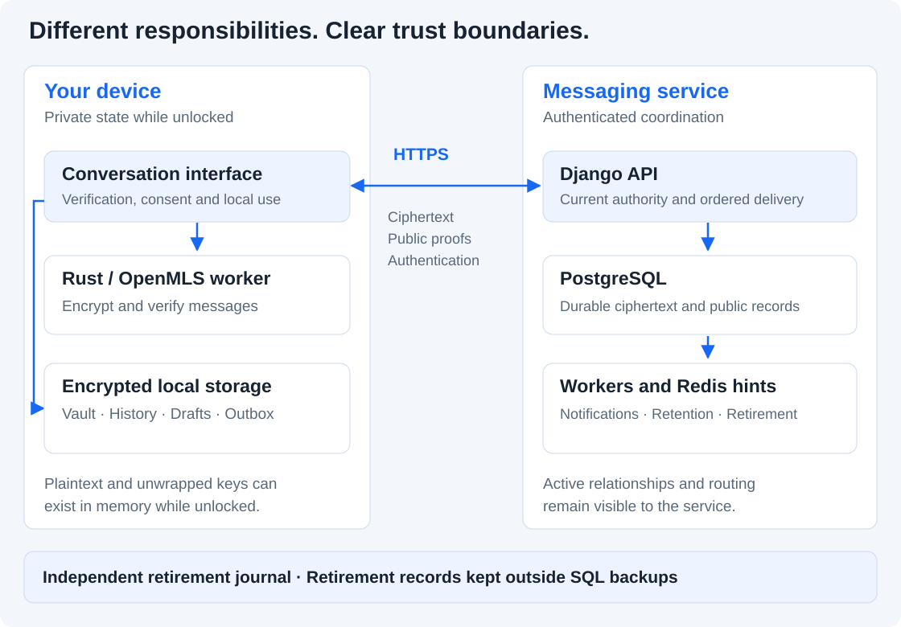
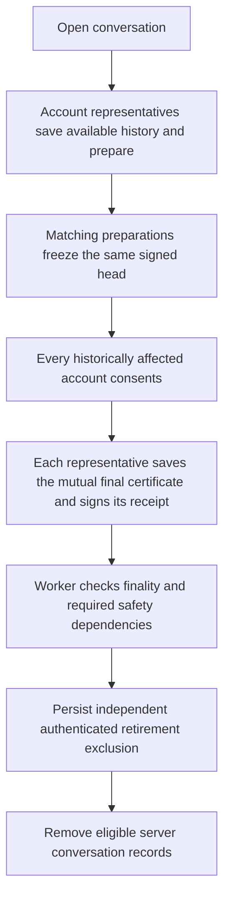
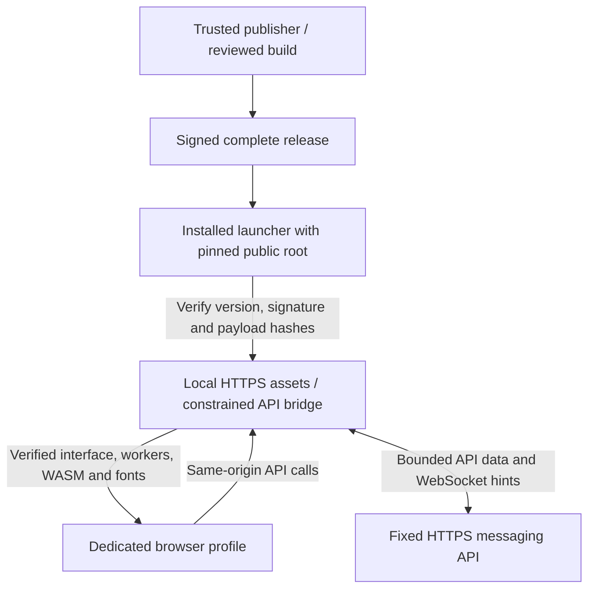

# Architecture

HAVEN separates the work of a messaging service from the private state held by its clients. The shared React interface runs as an ordinary website, an independently delivered web frontend, or a signed installed Linux client. All three use the same OpenMLS adapter and encrypted local-storage model; their code-delivery trust is different.

This page describes the current implementation. [ADRs](../adr/) preserve the choices and constraints at their recorded dates; [security status](../../SECURITY_STATUS.md) defines the current assurance boundary.

## State and responsibility

[](../../.github/assets/architecture.svg)

| Component | Responsibility | State and trust |
|---|---|---|
| Shared client UI | Conversation workflow, verification, local previews, consent and operational feedback | Plaintext is available while a device is unlocked. The UI must be trustworthy. |
| Rust/OpenMLS worker | RFC 9420 group operations and authenticated message processing | Private MLS/provider state belongs to the device; operations are serialized. |
| Local vault worker and IndexedDB | Protect checkpoints, segmented history, drafts/outbox and separate final archives | Records are encrypted at rest; atomic transactions and stale-writer/lock checks protect local continuity. |
| Django API / Channels | Authenticate current sessions/devices, enforce membership/quotas, order signed records, coordinate media and closure | Processes authentication/routing/public metadata and encrypted payloads; not a blind or anonymous relay. |
| PostgreSQL | Authoritative ordered envelopes, public control proofs, account/device authority, delivery cursors, outbox and resource accounting | Durable commit precedes acceptance. Roles separate migration, main runtime and notification access. |
| Redis | Transient synchronization hints, bounded routing associations and limits | Loss of a hint does not remove the authoritative SQL record. HMAC labels reduce direct identifiers, not privileged observation. |
| Background workers | Publish committed notifications, maintain expiry/retention and retire eligible conversations | Eligibility is rechecked against current durable state. Notification SQL access is deliberately narrow. |
| Independent retirement journal | Authenticated permanent exclusions used during retirement and SQL restore | Separate from the SQL snapshot being restored. Its current protected key/copy must survive. |

The client uses OpenMLS suite `0x0001` (X25519, AES-128-GCM, SHA-256 and Ed25519). Vault secrets use the implemented Argon2id profile, with authenticated encryption through libsodium; attachments use independent keys and authenticated XChaCha20-Poly1305 chunks. These choices are implementations of established primitives, not evidence that the entire integration has been independently audited. [Crypto source](../../packages/crypto-core/src/lib.rs), [vault worker](../../apps/web/src/lib/vault-worker.ts), [media](../../apps/web/src/lib/media.ts), [provider maintenance](../adr/0010-upstream-provider-security-backport.md).

## What each side can see

The normal messaging protocol does not give the server a client's private MLS state or attachment decryption keys. It still needs account/device identities, current authorization and group membership, ordered signed public history, pending ciphertext and delivery state. Authentication data is processed by the service under TLS. A live server/hosting observer can see processing metadata, and a database snapshot reveals relationships and other retained fields.

On an unlocked device, plaintext and unwrapped keys are available to the application. A locked vault protects encrypted records at rest; it does not remove every identifier/preference or promise secure erasure of browser/OS memory. Recipient devices can retain or capture the plaintext they legitimately receive. [Threat and metadata analysis](../security/metadata-privacy/threat-model.md).

## The message journey

```mermaid
sequenceDiagram
  participant S as Sender client
  participant V as Sender encrypted vault
  participant A as API / PostgreSQL
  participant R as Recipient client
  participant RV as Recipient encrypted vault
  S->>S: Encrypt and prepare authenticated request
  S->>V: Atomically save crypto state and pending ciphertext
  V-->>S: Local commit succeeds
  S->>A: Submit saved request
  A->>A: Check current authority and commit ordered record
  A-->>S: Return acceptance
  Note over S,A: Lost reply: retry the same saved request bytes
  R->>A: Authenticated HTTP synchronization
  A-->>R: Encrypted envelopes and signed public history
  R->>R: Verify history, sender and MLS context; decrypt
  R->>RV: Commit encrypted local state and history
  RV-->>R: Local commit succeeds
  R->>A: Acknowledge durable local state
```

The figure omits hints and the sender's later acceptance reconciliation for clarity. The [messenger](../../apps/web/src/lib/messenger.ts) preserves speculative/pending state until acceptance is reconciled, rather than pretending an uncertain request was never sent. The [server protocol](../../apps/api/core/protocol.py) preserves authenticated ordering and idempotent retries. Notifications wake synchronization; clients retrieve the authoritative records over HTTP.

Three observations remain separate: **server acceptance**, **recipient durable local storage**, and **human reading**. A network exchange is not exactly-once transport, and local history checks are not global consensus or a proof that every server view is identical.

### Local persistence and failure

Checkpoint replacement and changed encrypted history records share an IndexedDB transaction. Unchanged history records can be reused; changing the local secret rewraps the relevant history under the new secret. Web Locks, revision checks and lock-generation checks reject stale writers and prevent late asynchronous work from repopulating a locked vault.

Storage exhaustion preserves the last durable state and refuses unsafe progress. Application content is validated only after the transport, history, MLS sender/epoch and membership checks. Authenticated malformed application content can be recorded as rejected so later valid traffic can continue; failed cryptographic or membership checks remain failures. [Storage/sync decision](../adr/0012-review-remediation-storage-and-sync.md).

### Current authority under concurrency

A valid old signature or cached membership result is insufficient when a device/session has since been revoked. Protected operations refresh current authority, and relevant account/conversation mutations use explicit locking/fences. Shared transaction rules prevent handled failures from leaving partial accepted writes. Media/view-once leases and cleanup share the required locks.

Bounded API processes, connection pools, WebSocket workers, request/resource limits and transactional budget accounting control resource use without weakening durable-before-acceptance behavior. These engineering choices do not establish a capacity SLA. [Authority decision](../adr/0014-request-authority-and-enrollment-retention.md), [runtime decision](../adr/0015-bounded-api-runtime-and-storage-locks.md).

## Media and temporary access

Ordinary media is encrypted in authenticated chunks with bindings to the conversation, attachment and chunk positions. Descriptive metadata and keys travel inside encrypted messages. Local previews use temporary object URLs and are released on replacement, cancellation, send or lock. Unsupported active documents are not embedded as previews.

View-once adds an account-wide opening policy, not an unrecordable form of media. Server authorization, device-bound capabilities and leases cooperate with temporary client presentation and replay tombstones. Screenshots, altered recipients and retained copies remain possible. View-once is excluded from history/closure archives. [Media rules](../adr/0005-view-once-media.md), [viewer](../../apps/web/src/app/view-once.tsx).

## Two different retention paths

### Routine ciphertext cleanup

After the minimum age, cleanup can retire delivered application ciphertext only when every eligible device has durably acknowledged it. Required public/control history remains for synchronization and verification. An offline device of the same account is not represented by another device's ACK for this policy. Attachments and temporary auth/routing records have their own bounded lifetimes. Eligibility is not an immediate-deletion promise. [Exact retention rules](../security/server-data-retention.md).

### Mutual account-wide closure

One approved participating device can represent an account under the signed v2 policy. Every historically affected account must agree, including former group members. Available local archives, matching preparations, explicit consent and saved final certificates/receipts precede worker retirement.



Every arrow is conditional. Missing consent or changed authority retains server history; preparation pauses account sending and currently cannot be cancelled or transferred. Archives contain available authenticated history and disclosed available ordinary media, not a guaranteed complete copy from every device. They are read-only history, not live ratchet restores.

Retirement removes eligible conversation/membership/envelope/control/media records while preserving accounts/devices and minimal replay exclusions. The independently authenticated journal is persisted before SQL removal. Restore tooling uses it to reject resurrection from older SQL snapshots. It cannot erase old backups, WAL, recipient exports, observations or physical traces; losing or rolling back every independent journal/key copy cannot be repaired cryptographically. [Current policy](../security/account-closure/README.md), [implementation](../../apps/api/core/graph_retirement.py), [restore procedure](../security/account-closure/operations.md).

## Three client-delivery models

The message protocol is shared, but the source of executable code is a separate trust decision.

| Delivery | Executable source | Remaining trust |
|---|---|---|
| Same-origin website | Messaging website | The origin can replace newly loaded client code. |
| Independent web frontend | Separate frontend host | Protects against backend-only code delivery; the frontend host still controls executable assets. |
| Verified installed Linux client | Independently trusted signed release | Initial launcher/root, publisher/build and local browser/OS remain trusted. |



The local bridge serves code from verified payloads and refuses API-supplied HTML/executable responses, redirects and untrusted origin/header policy. Installed mode does not register a service worker. Signed manual updates use a monotonic installed-state floor, separate dependency environments and locks held across runtime/browser lifetime.

A separately deployed web gateway uses the same verified bundle, but the browser still trusts that host to deliver it. Two containers on one development host do not protect against host-root compromise. Neither mode fixes a compromised publisher, browser, OS or hostile authorized recipient. [Delivery operations and verification](../security/client-delivery/README.md).

## Deployment and review paths

The [standard compose stack](../../infrastructure/compose/compose.yml) runs TLS ingress, web/API, PostgreSQL, Redis and separate maintenance workers. The [independent frontend compose file](../../infrastructure/compose.client.yml) needs its own origin, TLS material and fixed API identity, without backend database credentials. Installed clients run on user devices; the service setup wizard does not perform their independent first-trust ceremony.

Public certificate trust/renewal, host hardening, independent signer/frontend custody, backup/journal protection and field reachability remain deployment responsibilities. The maintained local installation is engineering evidence, not a qualification of every host or physical phone. Origin changes require a distinct approved device or explicit supported recovery/history import; they do not migrate browser keys automatically.

Continue with [security decisions](../security/design-guide.md), [operations](../runbooks/operations.md), [development](../development.md), or [verification](../../TEST_REPORT.md).
