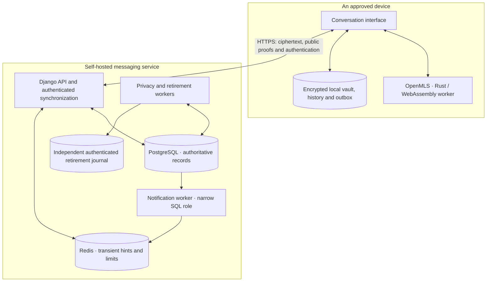
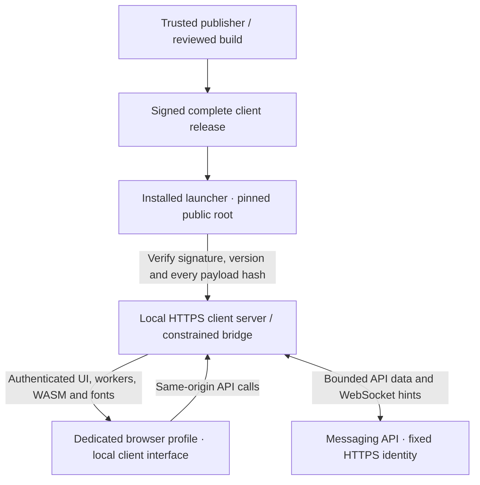
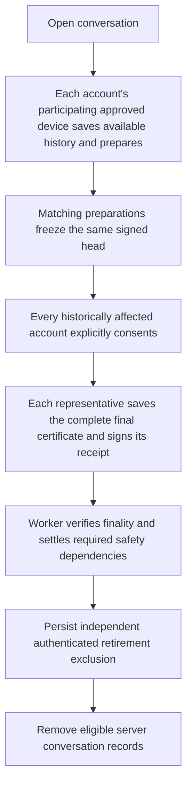

# Diagram and visual storyboard

These are the semantic drafts used for the rewrite. The implemented SVG and Mermaid explanations are in the [architecture guide](../architecture/README.md); this storyboard remains planning history. The first diagram is suitable for the README; the more detailed sequences can live in the architecture/security guide and be linked or disclosed from the entry page.

## System overview

Question answered: **Where do encryption, local state and durable delivery happen?**



Caption: encryption/decryption and private message-key state belong to the client. PostgreSQL accepts durable encrypted envelopes and public/authentication/routing records. Redis helps a client discover changes; it is not the durable message store. The service still sees authenticated relationships and processing metadata. Plaintext and unwrapped keys exist on an unlocked device.

The overview separates storage responsibilities. It is not a deployment topology or claim of network isolation. Installed and web clients use different code-delivery paths; the next diagram explains that distinction. The journal must survive independently of the SQL backup being restored.

## Installed client: code and data follow different trust paths

Question answered: **Why does the installed client change the API-origin threat?**



Caption: the messaging API does not supply executable assets to this installed interface. Initial launcher/root trust, the publisher/build, OS and browser remain part of the trust model. The diagram describes a portable Linux installation, not an app-store-signed native/mobile application.

Pair this with a three-row comparison rather than force all delivery modes into one crowded diagram:

| Mode | Who supplies client code? | Trust that remains |
|---|---|---|
| Ordinary website | Messaging website/operator | That origin can change code |
| Independent web frontend | Separately controlled frontend host | Frontend host still supplies executable code |
| Verified installed client | Independently trusted signed release | Publisher/build and local runtime/device remain trusted |

When this is rendered as custom artwork, the code-delivery and message-data paths need different labels and line styles, not only different colors. Do not draw the API as unable to deny service or as unable to observe routing.

## Message journey

Question answered: **What do saved, accepted and delivered actually mean?**

```mermaid
sequenceDiagram
  participant S as Sender client
  participant V as Sender encrypted vault
  participant A as API / PostgreSQL
  participant R as Recipient client
  participant RV as Recipient encrypted vault
  S->>S: Encrypt and prepare authenticated request
  S->>V: Atomically save crypto state and pending ciphertext
  V-->>S: Local commit succeeds
  S->>A: Submit saved request
  A->>A: Check current authority; commit durable ordered record
  A-->>S: Return acceptance
  Note over S,A: Lost reply: retry the same saved request bytes
  R->>A: Authenticated HTTP synchronization
  A-->>R: Encrypted envelopes and signed public history
  R->>R: Verify order, sender and MLS state, then decrypt
  R->>RV: Commit encrypted local state/history
  RV-->>R: Local commit succeeds
  R->>A: Acknowledge durable local state
```

Caption: the diagram omits notification hints for clarity. A hint prompts synchronization and does not replace the HTTP exchange. It also omits the sender's acceptance reconciliation and exceptional rekey/recovery paths, which the detailed guide must describe. Server acceptance, recipient durable storage and a human read are distinct states.

## Mutual closure and retirement

Question answered: **How does a conversation end without one participant deciding for everyone?**



Caption: one participating device represents each account; a direct chat needs both accounts, and groups need every historically affected account including former members. Missing consent or changed authority preserves server history and can leave the conversation paused. Preparation currently cannot be cancelled or transferred. View-once content is excluded from the available-history archive. Ordinary per-device ACK-based ciphertext cleanup is a different policy.

The final graphic should show that progress is conditional. Do not imply that every proposal automatically reaches deletion or that retirement erases backups, WAL, old observations or recipient copies. Link the independent journal's restore procedure and its loss/rollback limits.

## Product imagery and cover

| Asset | What it should communicate | Production rule |
|---|---|---|
| Compact hero | HAVEN name, established voice and the device/service boundary | Editable vector first; essential introduction remains real Markdown |
| Main conversation | A functioning messenger with clear everyday interactions | Capture a current isolated build with disposable synthetic people/messages; preserve actual review notices |
| Mobile/dark companion views | Responsive layout and deliberate themes | Current real captures with captions; do not imply physical iOS/Android testing from a desktop viewport |
| Device approval detail | Login and device trust are separate actions | Show real current UI with safe synthetic identifiers, no credentials, recovery keys or private conversations |
| Closure detail, if readable | Explicit consent and the archive/retirement consequence | Capture the real decision screen; keep its irreversible/pause information legible |
| Social preview | A concise truthful introduction outside the README | Match current wording and assurance state; export from editable source |

Generated cover art is optional. It must never manufacture UI, audit badges or technical arrows. Keep a direct text explanation below every architectural visual, and do not depend on motion or a hosted explorer to make the central story understandable.
