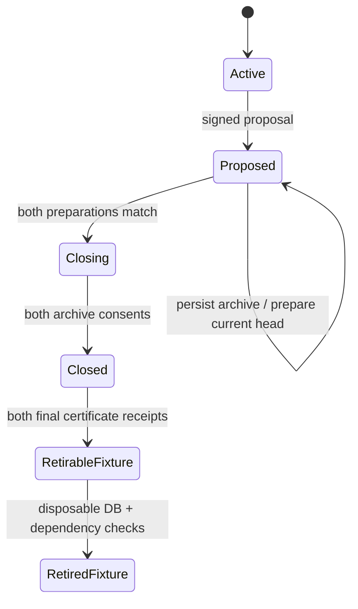

# Protocol and authorization invariants

This application-layer experiment leaves RFC 9420/OpenMLS primitives, the existing envelope domain, signature encoding and legacy genesis bytes unchanged. New closure artifacts use separately domain-separated canonical JSON and existing device Ed25519 keys. Domain/version names refer to this experimental schema, not to an independently reviewed interoperability standard.

A proposal binds conversation/group IDs, signed genesis hash, nonce, proposer, restore namespace, exact history sequence/hash/epoch, sorted certificates and roles, both account security generations, and complete-text archive policy. Later snapshots also commit to the proposal hash. Proposal anchoring is checked against its original signed envelope; an advancing peer does not invalidate the original proposal.

Preparation signs the snapshot hash and device ID. Archive consent additionally signs a randomized archive commitment: the random archive ID prevents a deterministic plaintext-history fingerprint. Commitments and signed public proofs are never represented as proof of human reading. The archive contains the complete decrypted local application events and public genesis/proof bundle, encrypted with the existing vault worker before its request is transmitted. Missing, locally imported/unverified, duplicate-sequence, quarantined or attachment history cannot satisfy preparation.

A final certificate includes the proposal, matching preparations and both archive consents. Its stable hash excludes receipt delivery state. Each final receipt signs this hash and the receiving device ID, after the full certificate and retry request have been encrypted and committed locally. Partial receipt maps are verified too. Receipt retries are deterministic and immutable. The first consenter obtains and saves the final certificate through refresh/background synchronization after the peer consents.

The server's sorted account fences serialize recovery, device approval/revocation and eligibility checks with closure mutations. The conversation lock linearizes messages, control events and matching preparations. Before both preparations match, an unprepared device can flush old queued messages. A prepared device cannot submit new writes. Closure status blocks writes even if the experimental route is subsequently disabled; rekey operations cannot replace closing/closed status. Account changes fail eligibility rather than substituting authority or manufacturing consent.

Previously accepted identical submissions remain idempotent after the write fence. Durable ACKs and history/proof reads remain available. New application/control submissions, attachment initialization, and unsupported reopening are rejected. Signed existing records are never rewritten to remove a participant.

The client verifies every proof's signature, sender membership, scope, sequence, previous hash, epoch, transition and final head, using independently pinned devices for live closure. Offline import verifies the bundle and mutual signatures without installing trust pins or resuming a group. Local final certificates fence server status/finality downgrades; this does not defeat arbitrary rollback when every client checkpoint and server marker is also lost.

No abort/reopen protocol is included. A participant who prepares may remain permanently read-only if the other participant disappears. This explicit availability cost avoids treating a timer, owner privilege or implicit recovery as consent. Groups, historical participant sets, multi-device consent, media/view-once retirement and automatic deletion require separate protocol work and review.
