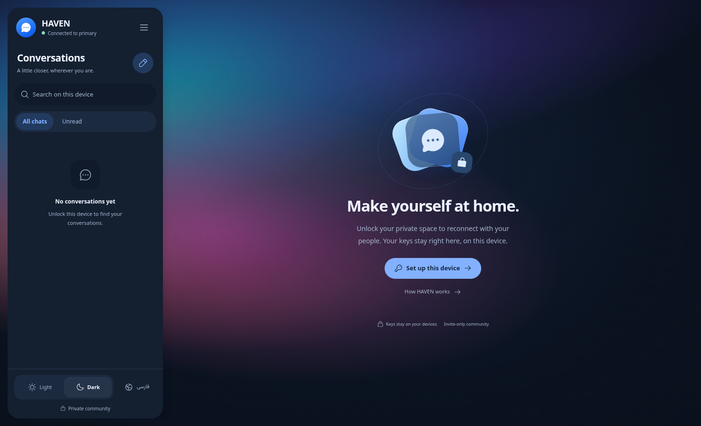

# One sidebar, more room for conversation

After sign-in, HAVEN has no global toolbar. Its identity, observed connection
state, navigation and appearance preferences live in one rounded sidebar.
The chat header and composer keep their own space over the aurora canvas.

The sidebar has three stable areas:

- Identity and connection status, followed by the menu action.
- A scrollable conversation list with search and filters. On auxiliary pages,
  this area becomes navigation for settings, trust, devices and recovery.
- A fixed footer with a sliding light/dark selector and a language action.

This avoids adding a settings rail alongside the conversation list. The native
navigation dialog keeps account actions and provides the same preferences when
using auxiliary pages on a phone. It retains focus containment, Escape/outside
dismissal and focus restoration. Active phone chats keep the full workspace;
returning to conversations reveals the sidebar again.

English and Persian use the same logical layout, with an RTL selection slide
and visible status text. Preference controls retain 44px targets. Reduced motion
removes the selection slide, icon turn, connection ring and menu animation.
All appearance changes use the existing local preferences; they make no external
requests and do not alter device trust or vault state.

[Settings navigation](../evidence/sidebar-settings.png) ·
[Persian phone layout](../evidence/sidebar-mobile-rtl.png)

Qualification used isolated synthetic accounts, trusted test TLS and the real
messaging API. Five selected cases passed in each of Chromium and Firefox:
encrypted chat/composer/media/responsiveness, design and keyboard navigation,
CSP, the RTL friend-link guide, and passphrase generation/cancellation/RTL with
an explicit unavailable-service UI response. The old source-only gate assumption
was replaced by that explicit response; operational defaults were not changed.
Twenty-eight combinations of width, theme and language passed layout checks,
including pinned preferences, 44px targets, reduced motion and offline status.
Both production builds and TypeScript passed. Screenshots contain test data.
